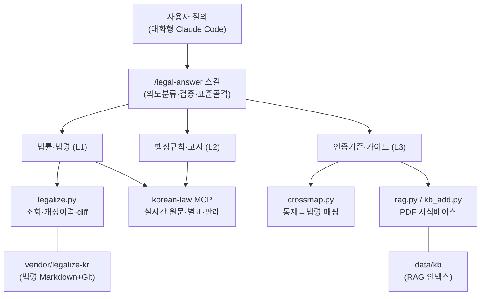
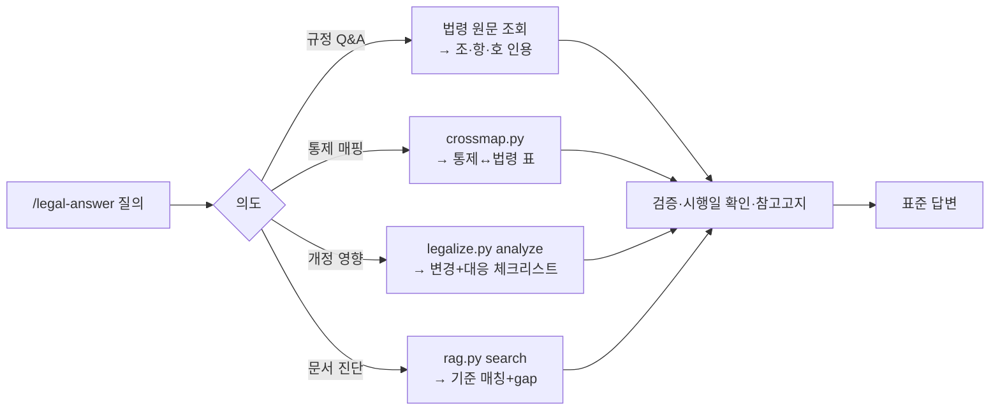

# 법령 기반 컴플라이언스 AI 어시스턴트

전자금융·개인정보·정보보호 규제(전자금융거래법·정보통신망법·신용정보법·개인정보보호법·위치정보법·ISMS-P 등)에 대해
**근거 조문을 실제로 조회·검증해서** 답하는 컴플라이언스 어시스턴트입니다. 소송/판례 검색기가 아니라 **규제 준수 지원 도구**입니다.

핵심 원칙: **근거 없는 단정 금지 · 조문 지어내기 금지 · 시행일 정확성 · 계층(법령/고시/인증기준) 구분.**

---

## 구조



데이터 계층은 **L1 법령**(legalize-kr/MCP) · **L2 행정규칙·고시**(MCP) · **L3 인증기준·점검항목·가이드**(정형화 JSON + RAG)로 구성됩니다. 자세한 설명은 [docs/](docs/)를 참고해 주세요.

---

## 사용 방법

### STEP 0. 요구사항
- Python 3.10+ / Git / [Claude Code](https://claude.com/claude-code) CLI
- Node.js 18+ (`npx`) — 법령 MCP 서버 로컬 실행용 (STEP 3)
- (선택) 법제처 Open API 인증키 — MCP 실시간 조회용

### STEP 1. 저장소 준비
```bash
git clone https://github.com/3iuy-prog/law-assist ~/workspace/law-assist && cd ~/workspace/law-assist
python3 -m pip install --user -r requirements.txt      # pypdf (RAG용)
python3 -m pip install --user sentence-transformers    # (선택) RAG 의미검색 — 약 3GB + 모델 2.3GB
python3 -m pip install --user docling                  # (선택·권장) PDF → Markdown 변환(tools/pdf2md.py)
mkdir -p ~/.claude/skills && ln -s "$PWD/skills/legal-answer" ~/.claude/skills/legal-answer   # /legal-answer 스킬 전역 등록
ln -s "$PWD/skills/kb-table-verify" ~/.claude/skills/kb-table-verify                           # 변환 표 시각 대조 스킬
# Windows(관리자 권한 없이): New-Item -ItemType Junction -Path "$env:USERPROFILE\.claude\skills\<스킬>" -Target "<저장소>\skills\<스킬>"
# (선택·권장) poppler — Claude가 PDF 쪽을 이미지로 읽어 표를 대조(kb-table-verify). Windows: winget install oschwartz10612.Poppler / macOS: brew install poppler
echo "export COMPLIANCE_AI_HOME=\"$PWD\"" >> ~/.zshrc && source ~/.zshrc                              # 스킬이 저장소 도구를 찾는 경로 (bash면 ~/.bashrc)
```
> 스킬은 홈에 심볼릭 링크로 등록되므로 **어느 디렉터리에서 `claude`를 열어도** `/legal-answer`를 쓸 수 있습니다.
> 스킬은 `COMPLIANCE_AI_HOME`로 저장소의 도구를 절대경로 호출합니다. 위 `echo` 줄이 clone 위치를 영구 등록하며, 미설정 시에는 `~/workspace/law-assist`를 가정합니다.

### STEP 2. 법령 데이터 받기 (legalize-kr)
개정이력·diff 기능(P3)에 쓰이는 데이터입니다. 약 1GB(전체 Git 히스토리, 2026-11 기준)입니다.
```bash
git clone https://github.com/legalize-kr/legalize-kr vendor/legalize-kr
```
> `vendor/`는 용량이 커서 커밋되지 않습니다. 각자 clone 해 주세요.
> 이후 최신화는 자동입니다 — `legalize.py`가 실행할 때마다 원격 최신 여부를 확인해 맞춥니다(하루 1회, 즉시 갱신은 `python3 tools/legalize.py sync`).

### STEP 3. 법령 MCP 연결 (실시간 원문 조회)
1. [법제처 Open API](https://open.law.go.kr/LSO/openApi/guideList.do)에서 회원가입 후 인증키(OC)를 발급받습니다.
2. 키를 환경변수로 등록합니다.
   ```bash
   echo 'export LAW_OC="발급받은_OC값"' > .env      # .env 는 .gitignore 됩니다
   source .env
   ```
3. 대화형 `claude`를 실행한 뒤 `korean-law` MCP를 **승인**합니다(최초 1회).
   ```bash
   claude
   # 프롬프트에서 korean-law 서버 승인
   claude mcp list      # korean-law 가 ✓ 인지 확인
   ```
   MCP 서버를 따로 띄울 필요는 없습니다 — `claude`가 [.mcp.json](.mcp.json)을 읽어 `npx`로 로컬에서 자동 실행·종료합니다(그래서 Node.js 필요).
> MCP 없이도 STEP 2의 `legalize.py`로 대상 5법 조회는 가능합니다. MCP는 별표·판례·행정규칙 등 커버리지를 넓혀 줍니다. 설정 상세는 [docs/02-mcp-setup.md](docs/02-mcp-setup.md)를 참고해 주세요.

### STEP 4. 질문하기 (기본 사용)
대화형 `claude`에서 **/legal-answer** 스킬로 질문하시면 됩니다. 스킬이 근거 조회·검증·표준 형식을 강제합니다.
```
/legal-answer 개인정보보호법상 개인정보 유출 통지는 며칠 이내에 해야 하나?
/legal-answer '접근권한 최소화' 통제에 관련되는 법령과 ISMS-P 인증기준을 매핑해줘
/legal-answer 개인정보보호법 2026-03-10 개정으로 뭐가 바뀌었고, 시행일별로 우리가 뭘 대응해야 하나?
```
질의 유형에 따라 자동으로 흐름이 갈립니다.



### STEP 5. 새 가이드/고시 PDF를 지식베이스에 추가 (L3 확장)
답변에 필요한 안내서·점검기준이 없으면 PDF를 흡수시키면 됩니다.
```bash
# URL에서 바로 (공식 출처 권장)
python3 tools/kb_add.py "<PDF_URL>" --collection <이름> --name <파일명.pdf>
# 로컬 PDF는 직접 인그레스트
python3 tools/pdf2md.py <파일.pdf>                       # (권장) 표·구조를 살린 md로 변환 + 원문 대조
python3 tools/rag.py ingest <파일.md> --collection <이름>  # md 대신 pdf를 바로 넣어도 됨
# 검색 확인
python3 tools/rag.py search "<질의>" --collection <이름> -k 5
```
> ⚠️ **최신 개정 반영본**인지 반드시 확인해 주세요(연도만 보고 옛 버전을 넣지 않도록 주의). 상세는 [docs/05-rag.md](docs/05-rag.md)를 참고해 주세요.

---

## 도구 직접 사용 (참고)

| 도구 | 용도 | 예시 |
|---|---|---|
| [tools/legalize.py](tools/legalize.py) | 법령 조회·개정이력·diff | `python3 tools/legalize.py show 개인정보보호법 --jo 29 --as-of "$(date +%F)"` |
| [tools/crossmap.py](tools/crossmap.py) | 통제↔법령 크로스매핑 | `python3 tools/crossmap.py by-law 개인정보보호법 --jo 29` |
| [tools/pdf2md.py](tools/pdf2md.py) | PDF → Markdown(표·쪽 표시 유지, 원문 대조) | `python3 tools/pdf2md.py data/kb_src/안내서.pdf` |
| [tools/relations.py](tools/relations.py) | 인그레스트 시 관계 추출(ISMS-P 관련 법규)·역방향 조회 | `python3 tools/relations.py by-item 2.9.4` |
| [tools/kb_fix.py](tools/kb_fix.py) | 변환 md의 한 쪽을 검증된 교정본으로 교체(원본에 없는 단어 거부) | `python3 tools/kb_fix.py data/kb_src/안내서.md --page 96 --file 교정본.md --check` |
| [tools/rag.py](tools/rag.py) | PDF 지식베이스 검색(키워드+의미 하이브리드) | `python3 tools/rag.py search "접속기록 보관" --collection isms` |
| [tools/kb_add.py](tools/kb_add.py) | URL→다운로드→인그레스트 | `python3 tools/kb_add.py "<url>" --collection fsec` |

- `legalize.py`는 최신 공포본이 아직 시행 전이면 **⚠️ 시행예정본 경고**를 냅니다. 오늘 현행본은 `--as-of <오늘>`로 조회해 주세요.
- `legalize.py`는 실행 시 vendor 저장소를 자동으로 최신화합니다(하루 1회 확인, 생략은 `--no-sync`, 즉시 갱신은 `sync`).
- `crossmap.py validate`로 매핑의 ISMS-P 코드 정합성을 자동 검사할 수 있습니다.

---

## 스킬 · 문서
- **스킬**: [skills/legal-answer](skills/legal-answer/SKILL.md) — 표준 답변(근거 인용·계층 태깅·시행일 as-of·환각 가드·참고 고지). `~/.claude/skills/legal-answer`에 심볼릭 링크로 전역 등록(STEP 1)
- **규약**: [CLAUDE.md](CLAUDE.md) — 이 저장소의 출력 규약(MANDATORY)
- **문서**: [docs/00-data-sources.md](docs/00-data-sources.md) 데이터 갭 · [docs/01-architecture.md](docs/01-architecture.md) 아키텍처 · [docs/02-mcp-setup.md](docs/02-mcp-setup.md) MCP · [docs/03-legalize-integration.md](docs/03-legalize-integration.md) legalize-kr · [docs/04-p2-p3-implementation.md](docs/04-p2-p3-implementation.md) 매핑/개정영향 · [docs/05-rag.md](docs/05-rag.md) RAG

---

## 사용한 외부 도구 · 데이터

| 항목 | 출처 | 용도 | 라이선스/비고 |
|---|---|---|---|
| **legalize-kr** | [github.com/legalize-kr/legalize-kr](https://github.com/legalize-kr/legalize-kr) | 법령 원문 + Git 개정이력 | MIT(구조) / 법령원문 공공저작물 |
| **korean-law MCP** | [github.com/chrisryugj/korean-law-mcp](https://github.com/chrisryugj/korean-law-mcp) | 실시간 법령·행정규칙·판례 조회, 인용 검증 | 해당 저장소 라이선스 |
| **법제처 Open API** | [open.law.go.kr](https://open.law.go.kr/LSO/openApi/guideList.do) | MCP 백엔드(OC 키 필요) | 공공데이터 |
| **ISMS-P 인증기준 안내서** | [개인정보보호위원회](https://www.pipc.go.kr) / KISA | L3 인증기준 RAG | 각 기관 저작물 |
| **개인정보 안전성 확보조치 기준 안내서** | [개인정보보호위원회](https://www.pipc.go.kr) | L2/L3 고시 해설 RAG | 각 기관 저작물 |
| **pypdf** | [pypi.org/project/pypdf](https://pypi.org/project/pypdf/) | PDF 텍스트 추출 | BSD |
| **docling** | [github.com/docling-project/docling](https://github.com/docling-project/docling) | PDF → Markdown(표·레이아웃 인식) | MIT |
| **Claude Code / Agent SDK** | [claude.com/claude-code](https://claude.com/claude-code) | 실행 환경·오케스트레이션 | Anthropic |

> 도구(`tools/`)는 순수 파이썬 stdlib 기반입니다(RAG의 PDF 처리만 pypdf 필요). 외부 API 키 없이 오프라인으로 동작합니다. `sentence-transformers`를 설치하면 RAG가 로컬 임베딩으로 의미검색을 더하며, 별도 임베딩 API는 필요 없습니다. 단, 검색 결과와 Claude Code가 읽는 문서는 답변 생성을 위해 Anthropic API로 전송되므로, 사내 문서를 넣을 때는 조직의 AI 사용 정책을 확인해 주세요.

---

## 라이선스

이 저장소의 **코드·문서·데이터 구조**는 MIT License로 배포합니다.

```
MIT License

Copyright (c) 2026 법령 컴플라이언스 AI 어시스턴트 프로젝트

Permission is hereby granted, free of charge, to any person obtaining a copy
of this software and associated documentation files (the "Software"), to deal
in the Software without restriction, including without limitation the rights
to use, copy, modify, merge, publish, distribute, sublicense, and/or sell
copies of the Software, and to permit persons to whom the Software is
furnished to do so, subject to the following conditions:

The above copyright notice and this permission notice shall be included in all
copies or substantial portions of the Software.

THE SOFTWARE IS PROVIDED "AS IS", WITHOUT WARRANTY OF ANY KIND, EXPRESS OR
IMPLIED, INCLUDING BUT NOT LIMITED TO THE WARRANTIES OF MERCHANTABILITY,
FITNESS FOR A PARTICULAR PURPOSE AND NONINFRINGEMENT. IN NO EVENT SHALL THE
AUTHORS OR COPYRIGHT HOLDERS BE LIABLE FOR ANY CLAIM, DAMAGES OR OTHER
LIABILITY, WHETHER IN AN ACTION OF CONTRACT, TORT OR OTHERWISE, ARISING FROM,
OUT OF OR IN CONNECTION WITH THE SOFTWARE OR THE USE OR OTHER DEALINGS IN THE
SOFTWARE.
```

단, **법령 원문·행정규칙·인증기준 안내서 등 원자료는 각 소관기관의 저작물**이며 해당 이용조건을 따릅니다(대한민국 법령은 공공저작물). 이 저장소는 원자료를 재배포하지 않고 참조·조회합니다.

---

> ⚠️ 본 도구의 답변은 **참고용이며 법률 자문이 아닙니다.** 실제 적용 전 최신 개정본과 소관기관 유권해석을 반드시 확인해 주세요.
