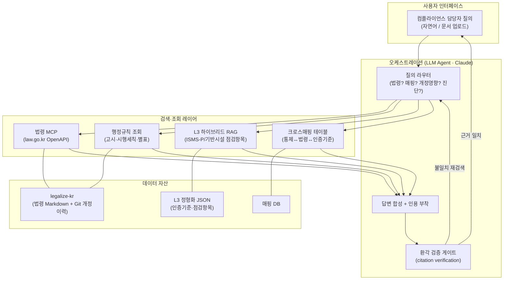
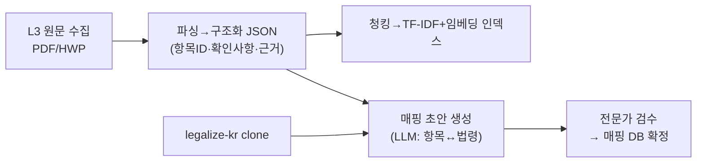

# B. 아키텍처 설계 (Architecture)

> 설계 원칙: 이 서비스는 "소송/판례 검색기"가 아니라 **금융보안·개인정보 컴플라이언스 어시스턴트**다.
> 따라서 차별화는 판례 커버리지가 아니라 **① 규정↔통제 크로스 매핑, ② 개정 영향 분석, ③ 원문 근거 기반 환각 검증**에서 나온다.

---

## 1. 시스템 구성도

---

## 2. 컴포넌트 역할

| 컴포넌트 | 역할 | 구현 |
|---|---|---|
| **질의 라우터** | 질문 의도 분류 → 4개 파이프라인 중 선택 | LLM 함수호출/분기 |
| **법령 MCP** | L1 법령 본문·조문 실시간 조회 | `chrisryugj/korean-law-mcp` (환각검증 내장) |
| **행정규칙 조회** | L2 고시·시행세칙·별표 조회 | 동 MCP의 행정규칙 도구 / `ChangooLee`(132도구) 대체 |
| **L3 하이브리드 RAG** | ISMS-P·기반시설 점검항목 검색(키워드+의미) | TF-IDF + 로컬 임베딩, RRF 결합 — [05-rag.md](05-rag.md) |
| **크로스매핑** | 통제↔법령↔인증기준 정합 조회 | 사전 구축 매핑 DB 질의 |
| **개정이력** | legalize-kr Git diff로 조항 변경 추적 | `git log -p` 파싱 |
| **환각 검증 게이트** | 답변의 조항 인용을 원문과 대조, 불일치 시 차단·재검색 | MCP citation verification |

---

## 3. 4대 파이프라인 (= 데모 시나리오)

### P1. 규정 Q&A + 근거 인용
> "위치정보사업자가 개인위치정보를 보관할 수 있는 기간은?"
- 법령 MCP로 위치정보법 해당 조문 조회 → 답변에 **조·항·호 원문 인용** → 환각 검증 통과 후 응답.

### P2. 크로스 매핑 (⭐ 킬러 기능)
> "접근통제(계정관리) 통제를 하나 구현하면 어떤 법·기준을 동시에 충족하나?"
- 매핑 DB 조회 → **ISMS-P 2.5.x ↔ 안전성확보조치 제5조 ↔ 개인정보보호법 제29조 ↔ 전자금융감독규정 제N조** 를 표로 반환.
- 실무 최대 페인포인트("한 번 구현으로 다중 규제 충족") 해소 → 활용 임팩트 최상.

### P3. 개정 영향 분석 (⭐ legalize-kr 차별화)
> "안전성확보조치 기준 제2026-9호(2026-07-01 일부개정)로 우리 내부규정 어디를 고쳐야 하나?"
- 법률·시행령 개정은 legalize-kr Git diff로, 고시(행정규칙) 개정은 법령 MCP로 현행 고시 원문·부칙(시행일)을 조회하고 최신 안내서 RAG의 제·개정 이력과 대조해 개정 전후 조항을 뽑는다(고시는 legalize-kr에 없다).
- 이어서 영향받는 통제항목 역매핑 → **변경 요약 + 대응 체크리스트** 생성.

### P4. 셀프 진단 (문서 업로드)
> 내부 보안정책 문서 업로드 → 관련 인증기준/법령 자동 매핑 → **미충족 항목 리포트**.
- 문서 파싱 → L3 RAG로 관련 통제 매칭 → gap 분석.

---

## 4. 기술 스택 (현실적 구성)

| 레이어 | 선택 | 비고 |
|---|---|---|
| LLM | **Claude Opus 5.5** (claude-opus-5-5) | 2026-11 기준 최신 Opus. 긴 법령 컨텍스트 유리 |
| Agent 런타임 | Claude Agent SDK / Claude Code | MCP 네이티브 연동 |
| 법령/행정규칙 | korean-law-mcp (chrisryugj) | 환각검증 + Claude Code 궁합 |
| 벡터 저장 | 컬렉션별 파일(`data/kb/<이름>/dense.npy`) + 전수 비교 | 수천 청크 규모라 벡터DB 불필요. 수십만 청크로 커지면 Chroma/pgvector 검토 |
| 임베딩 | **nlpai-lab/KURE-v1** (로컬, sentence-transformers) | 선택 설치. 미설치 시 TF-IDF만. 별도 임베딩 API 불필요(단, Claude가 읽는 내용은 Anthropic API로 전송) |
| 개정이력 | legalize-kr repo + `git` | diff 파싱 |
| 매핑 DB | SQLite/JSON | 사전 구축(반자동: LLM으로 초안→검수) |
| UI | Streamlit / Next.js | 데모 속도 vs 완성도 |

---

## 5. 데이터 파이프라인 (구축 순서)

1. **L3 수집·정형화**가 최우선 (A단계 결론). 데모 범위는 **개인정보 도메인 1개 축**으로 좁혀 깊게(ISMS-P 개인정보 파트 ↔ 안전성확보조치 ↔ 개인정보보호법).
2. 매핑은 LLM으로 초안 자동 생성 후 사람이 검수 → 정확도가 데모 신뢰도 결정.
3. legalize-kr은 clone만 하면 개정이력 즉시 활용.

---

## 6. MVP 범위 제안

- **필수**: P1(Q&A+인용) + P2(크로스매핑, 개인정보 축 한정) + 환각검증.
- **차별화 한 방**: P3(개정 영향분석) — legalize-kr Git diff 활용.
- **여유 시**: P4(문서 업로드 진단).
- 범위를 넓히기보다 **"근거 없는 답을 안 한다 + 규제 크로스매핑"** 두 메시지에 집중.

---

## 관련 문서
- [A. 데이터 소스](00-data-sources.md)
- [CLAUDE.md](../CLAUDE.md) — 출력 규약
